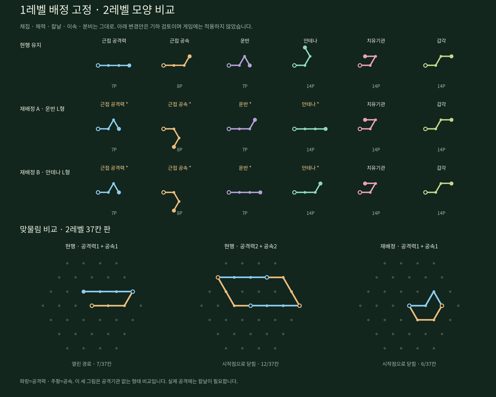

# 1레벨 확정 이후의 2레벨 배정 검토

사용자의 최신 지시는 **1레벨은 사용자가 배정 완료했으므로 고정하고, 2 → 3 → 4레벨을 순서대로 검토**하는 것이다. 이전의 1레벨 교환·익명 완성형 선택 대기는 현재 작업 범위가 아니다. 이번 자료는 2레벨의 첫 비교이며 제품 카탈로그·수치·가격·저장을 변경하지 않았다. 3·4레벨 배정은 결정하지 않았다.

고정한 1레벨은 채집 `[0,0]`, 체력 `[0,1]`, 칼날 `[0,2]`, 이속 `[0,5]`, 분비 `[0,4]`다. 분석기는 이 다섯 종류의 등급과 형태가 다르면 중단한다.

## 2레벨의 출발점

2레벨 DNA는 조각당 4접점·3선분이며 37칸 판에서 검토한다. 현재 해제되는 여섯 속성을 그대로 대상으로 삼았다.

| 속성 | 현행 형태 | DNA 한 조각 비용 |
|---|---|---:|
| 근접 공격력 | `[0,0,0]` | 7P |
| 근접 공속 | `[0,0,1]` | 8P |
| 운반 | `[0,1,5]` | 7P |
| 안테나 | `[0,1,2]` | 14P |
| 치유기관 | `[0,1,3]` | 14P |
| 갑각 | `[0,1,0]` | 14P |

배열은 절대 진행 방향을 나타낸다. 유닛 생산에는 위 합계와 별도로 기본 3P가 든다. 모양이 맞물려도 새 세트 효과나 수치 보너스는 생기지 않는다.

## 공격력·공속의 맞물림부터 비교

- **현행 유지:** 공격력1+공속1은 시작점으로 닫히지 않는다. 공격력2+공속2는 닫히는 경로가 있으며 12칸을 점유한다. 이 조각 네 개와 칼날 하나를 함께 넣는 43P 전투형도 실제 현재 카탈로그로 배치 가능하다.
- **재배정 A:** 공격력=`[0,1,5]`, 공속=`[0,5,4]`, 운반=`[0,0,1]`, 안테나=`[0,0,0]`. 치유·갑각은 유지한다. 공격력1+공속1부터 6칸 고리가 되며 여섯 속성의 서로 다른 윤곽도 유지한다.
- **재배정 B:** A의 운반과 안테나 모양을 바꾼다. 공격 쌍의 맞물림은 같지만 경제·정찰 조합에 주는 영향이 달라진다.

공격력·공속만 옮기면 운반·안테나와 모양이 겹치므로 A/B는 네 속성의 모양을 함께 재배정한 안이다. **1레벨 조각이나 2레벨 속성의 효과·가격은 바꾸지 않는다.**

변경안끼리는 A를 먼저 검토할 만하다. 아래 표본에서 운반 L형이 직선형보다 배치 경로가 많았다. 다만 이것은 선택한 역할 조합의 경로 수이며 모든 조합의 최적성·게임 밸런스·미적 우위를 증명하지 않는다. 현행 유지안도 유효하므로 재배정이 필수라고 결론내리지 않는다.

## 역할 조합 비교

다음 수치는 첫 조각의 회전을 0으로 정규화하고, 같은 종류의 중복 순서를 제거한 **유효 DNA 순서·회전 경로 수**다. 순수 점유 윤곽 종류의 수가 아니다. 시작점이 중앙인 모델의 실제 경계·경로 충돌·끝접점 합류를 전부 사용했다.

| 조합 | 비용 | 현행 | A | B |
|---|---:|---:|---:|---:|
| 공격력1·공속1 | 18P | 2 | 4 | 4 |
| 공격력2·공속2 | 33P | 21 | 53 | 53 |
| 칼날1·공격력2·공속2 | 43P | 92 | 355 | 355 |
| 채집2·운반1·체력1·이속1 | 40P | 1,048 | 1,130 | 908 |
| 안테나1·이속2·체력1 | 32P | 136 | 125 | 128 |
| 치유기관1·체력3 | 32P | 69 | 69 | 69 |
| 갑각2·체력3 | 46P | 134 | 134 | 134 |

처음 두 행은 **공격기관 없는 형태 표본**이다. 공격력·공속 강화만으로 공격 기능이 열리지 않는다. 칼날이 포함된 실제 전투형의 수치는 세 안 모두 HP10·공격10·공속0.7이다. 일꾼 표본은 HP20·운반4·4초당 채집2·이속0.29, 정찰 표본은 HP20·이속0.33·시야2·외부활동 가능, 치유 표본은 HP40·2초당 기본 치유1이다. 고정한 수량·등급이 같아 효과와 비용은 모든 안에서 같다. 배치 비교는 수입·전투 승률 실측이 아니다.

## 검증과 적용 경계

- 선택한 21개 대표 경로를 6회전씩 총126개로 확인했다. 기하 검사는 모두 통과했다.
- 현행안 대표7종의42방향은 실제 `validateDna`도 통과했다. A/B에서 바뀐 모양을 사용하는 표본은 현재 서버의 카탈로그 일치 검사에서 거부된다. 이는 아직 적용하지 않은 제안임을 뜻하며 검증 우회나 게임용 설계 파일로 내보내지 않았다.
- A/B의 치유·갑각 표본은 현행 모양을 사용하므로 그대로 검증된다. 검증 세부 결과는 `verification.json`에 분리했다.
- 선택한 대표의 대칭·작은 외곽·다음 조각 연결은 선별 기준이다. `extensions`는 현행 1레벨5종×6회전 중 이어 붙일 수 있는 수이며 향후 모든 고등급 연결 가능성을 뜻하지 않는다.
- 실제 재배정을 택하면 기존 저장 DNA의 모양 허용·마이그레이션과 편집기·런타임 동기화가 추가로 필요하다. 여기서는 수행하지 않았다.

다음 순서는 2레벨의 **현행 유지/맞물림 재배정** 방향을 정리하고, 3레벨의 강화 조합, 그다음 4레벨의 고급 기능·강화 조합을 검토하는 것이다. 1레벨을 다시 배정하는 단계로 돌아가지 않는다.

재계산: `node Research/Dna/2026-11-04/level2/analyze.mjs`

그림: `python Research/Dna/2026-11-04/level2/render.py` (Matplotlib와 Noto CJK 글꼴 사용)
